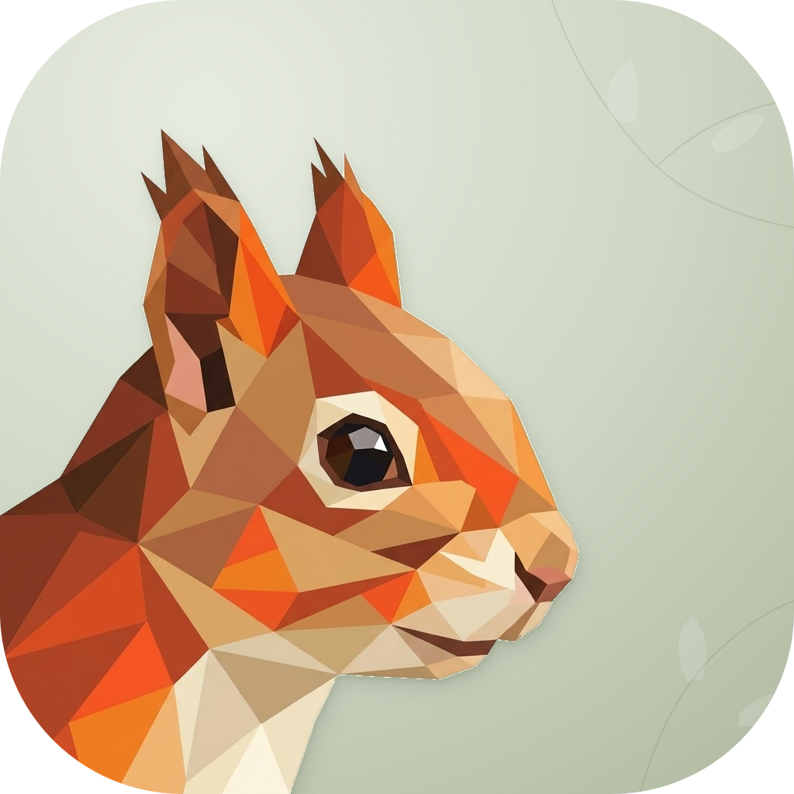

<p align="center">
  
</p>

# Squirrel（松鼠）

部署在 **Cloudflare Workers** 上的个人级 API Key / Token 托管服务，通过标准 **MCP（Streamable HTTP）+ OAuth 2.1 + 无头 Bot Bearer Token** 向 Gemini、Claude Code、Cursor 及自动化 Agent 按需分发低敏凭证。

## 核心能力

- **文件夹与单密钥细粒度授权**：支持创建文件夹归类凭证；每个 OAuth 客户端或 Bot Token 可独立配置「全部 / 指定文件夹（动态继承新增密钥）/ 指定单个密钥」与「允许读取明文 / 仅元数据」。
- **双模接入**：
  - **OAuth 2.1 + PKCE（RFC 9728 / 8414 / 7591 / 7009 / 8707 / 9207）**：兼容 Gemini Custom Connected Apps（含 3000+ 字符超长 `state`、`/authorize` KV 事务化、`GET /mcp -> 405`）。
  - **无头 Bot Bearer Token（`sq_live_...`）**：适用于无浏览器交互的 Agent 与 CI 脚本，支持一键轮换与吊销。
- **Web Crypto AES-256-GCM 加密**：每条密钥独立 12 字节随机 IV，绑定 `secret.id` AAD，主密钥由 Worker Secret `MASTER_KEY` 注入。
- **Cloudflare Access 管理面隔离**：`/admin/*`、`/api/admin/*`、`/authorize` 强制校验 `Cf-Access-Jwt-Assertion`，`/.well-known/*`、`/oauth/*`、`/mcp` 对公网放行。
- **可观测性与 90 天自动清理**：完整审计每次工具调用与后台明文查看（含 AI 声明 `reason`），每日 Cron 自动清理超过 90 天的历史日志。
- **Basalt 管理后台**：基于 React 19、Vite 8、Tailwind CSS v4 与 `@nocoo/basalt@^3.6.0` 构建。

## 快速开始

```sh
bun install --frozen-lockfile
bun run db:migrate      # 初始化本地 D1 表结构
bun run dev             # 启动本地服务 -> https://squirrel.dev.hexly.ai (127.0.0.1:7067)
```

## 文档目录

- [docs/README.md](docs/README.md) — 设计文档总索引
- [01. 概览与系统架构](docs/01-overview-and-architecture.md)
- [02. 数据模型、加密与授权策略](docs/02-data-model-and-crypto.md)
- [03. OAuth 2.1、Bot Token 与 MCP 协议规范](docs/03-oauth-and-mcp-protocol.md)
- [04. 管理后台与 API 规范](docs/04-admin-ui-and-api.md)
- [05. 本地开发、测试与部署运维](docs/05-development-and-operations.md)
- [AGENTS.md](AGENTS.md) — 工程约束、质量槽位与运行规范

## 许可证

[MIT](LICENSE)
